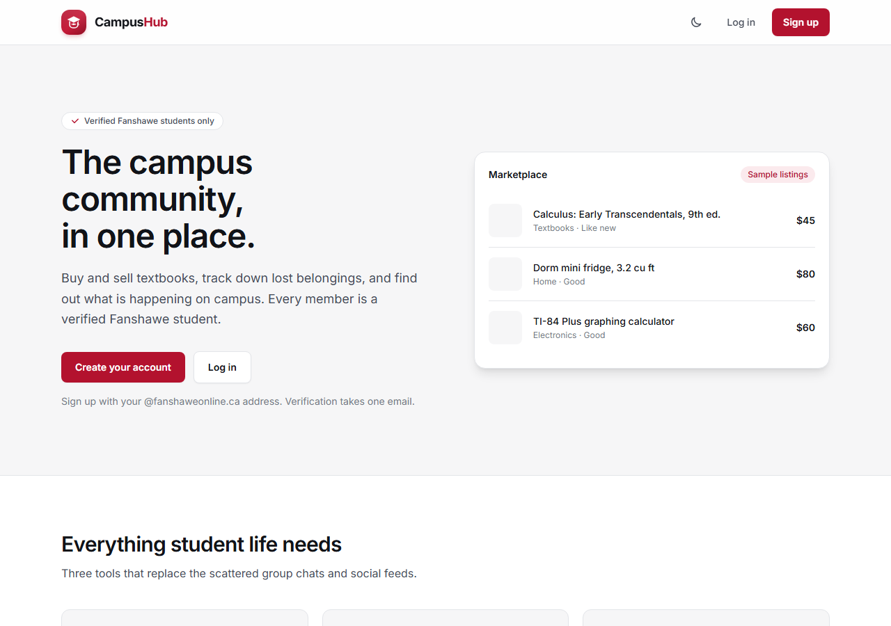

<div align="center">

# CampusHub

**One verified place for Fanshawe College students to buy and sell, find lost items, join events, form study groups, and share course notes.**

[](https://github.com/Youssefrajeh/Binaryminds/actions/workflows/ci.yml)


Team **Binary Minds** · INFO-5103 · Fall 2026



</div>

## Contents

- [Why CampusHub](#why-campushub)
- [Features](#features)
- [Tech stack](#tech-stack)
- [Project structure](#project-structure)
- [Getting started](#getting-started)
- [Environment variables](#environment-variables)
- [Scripts](#scripts)
- [Roles and the first administrator](#roles-and-the-first-administrator)
- [Feature guide](#feature-guide)
- [API reference](#api-reference)
- [Security and privacy](#security-and-privacy)
- [Testing](#testing)
- [Deployment](#deployment)
- [Updating an existing database](#updating-an-existing-database)
- [Documentation](#documentation)

## Why CampusHub

Student life is spread across group chats, notice boards, and public marketplaces, where you can't tell who you're dealing with. CampusHub brings it together behind Fanshawe email verification, so every member is a confirmed student.

## Features

| Area | What students can do |
|---|---|
| **Accounts** | Register with a Fanshawe email, verify it with an emailed code, reset a forgotten password |
| **Profiles** | Add a program, courses, and interests, and find other students by any of them |
| **Marketplace** | Post listings with photos, search and filter them, edit them, mark them sold, or delete them |
| **Messaging** | Chat in real time, with message requests, read tracking, typing indicators, and blocking |
| **Lost & Found** | Post lost or found items, filter by category, location, and date, and mark posts resolved |
| **Events** | Browse upcoming events, RSVP, keep a saved list, and message the organizer |
| **Study groups** | Create, join, and leave groups by course, each with its own group chat |
| **Course files** | Share notes in chat and browse study group files by course |
| **Safety** | Report content, and let administrators review reports, remove content, and suspend accounts |

## Tech stack

| Layer | Technology |
|---|---|
| **Frontend** | React 19, React Router, Vite, Tailwind CSS 4, TypeScript |
| **Backend** | Node.js, Express, Socket.IO, Zod, TypeScript |
| **Database** | MongoDB with Prisma ORM |
| **Auth** | JSON Web Tokens, bcrypt password hashing |
| **Email** | Brevo HTTPS API |
| **Testing** | Vitest, Testing Library, Supertest, disposable in-memory MongoDB |
| **Tooling** | npm workspaces, oxlint, GitHub Actions |

## Project structure

```text
apps/
  api/          Express API, Socket.IO server, and Prisma schema
  web/          React single-page app
packages/
  shared/       Types and helpers shared by the API and the web app
deploy/         Oracle Cloud setup scripts, Nginx, and systemd config
docs/           Build plan, architecture decisions, and screenshots
render.yaml     Render deployment blueprint
```

## Getting started

### Prerequisites

- [Node.js](https://nodejs.org/) 24, the version CI uses
- [Git](https://git-scm.com/)
- A [MongoDB Atlas](https://www.mongodb.com/atlas) cluster (the free tier works)

### 1. Clone and install

```bash
git clone https://github.com/Youssefrajeh/Binaryminds.git
cd Binaryminds
npm install
```

### 2. Create your environment file

```bash
# macOS, Linux, or Git Bash
cp apps/api/.env.example apps/api/.env

# Windows PowerShell
Copy-Item apps/api/.env.example apps/api/.env
```

Open `apps/api/.env` and set at least these two values:

```env
DATABASE_URL="mongodb+srv://<username>:<password>@<cluster>.mongodb.net/campushub"
JWT_SECRET="a-long-random-secret"
```

To find the connection string, open [MongoDB Atlas](https://cloud.mongodb.com/), select **Connect** on your cluster, and choose **Drivers**.

### 3. Set up the database

```bash
npm run prisma:generate -w @campushub/api
npm run prisma:push -w @campushub/api
```

### 4. Start the app

Run each command in its own terminal:

```bash
npm run dev:api    # API at http://localhost:4000
npm run dev:web    # Web app at http://localhost:5173
```

Open **http://localhost:5173**. The web app forwards `/api` requests to the API, so no extra setup is needed.

> Sign-up needs working email. Set `BREVO_API_KEY` and `EMAIL_FROM_ADDRESS`, or the app will start but verification codes won't be delivered.

## Environment variables

Set these in `apps/api/.env`.

| Variable | Required | Purpose |
|---|---|---|
| `DATABASE_URL` | Yes | MongoDB connection string |
| `JWT_SECRET` | Yes | Secret for signing login tokens |
| `BREVO_API_KEY` | For email | Brevo API key |
| `EMAIL_FROM_ADDRESS` | For email | Sender address validated in Brevo |
| `ALLOWED_EMAIL_DOMAIN` | No | The only email domain that may register |
| `PORT` | No | API port |
| `EMAIL_REPLY_TO` | No | Reply address for system emails; defaults to the sender |
| `APP_URL` | No | Public site URL, used for the logo in emails |
| `CLIENT_URL` | Production | Allowed web origin |

## Scripts

Run these from the repository root.

| Command | What it does |
|---|---|
| `npm run dev:api` | Starts the API and restarts it on changes |
| `npm run dev:web` | Starts the web app with hot reload |
| `npm run build` | Builds the shared package, API, and web app |
| `npm run typecheck` | Type-checks all workspaces |
| `npm run lint` | Lints all workspaces |
| `npm test` | Runs all tests |
| `npm run prisma:generate -w @campushub/api` | Regenerates the Prisma client after a schema change |
| `npm run prisma:push -w @campushub/api` | Applies schema changes to the database |
| `npm run admin:bootstrap -w @campushub/api -- <email>` | Promotes the first administrator |

## Roles and the first administrator

| Role | Can do |
|---|---|
| **Student** | Use all student features. Every new account starts here. |
| **Organizer** | Also create, edit, and cancel their own events |
| **Administrator** | Also manage roles, suspend accounts, and review reports |

There is no public administrator sign-up. To create the first one, register and verify the account, then run:

```bash
npm run admin:bootstrap -w @campushub/api -- your-verified-email@fanshaweonline.ca
```

This promotes the existing verified account, and it refuses to run if an administrator already exists. Refresh the page or sign in again afterward. Later role changes happen on **Admin users** (`/admin/users`).

## Feature guide

<details>
<summary><strong>Marketplace</strong></summary>

**My listings** narrows the board to your own items. The details page offers **Edit**, **Mark as Sold**, and **Delete**, and only the seller can use them, whatever their role. Sold listings stay readable with a badge. Deleting is a soft delete, so linked conversations stay valid.

**Message seller** opens a chat for that specific ad, showing its photo, title, price, and status. Repeat clicks reopen the same chat, and chats about different ads stay separate.

</details>

<details>
<summary><strong>Messaging</strong></summary>

A new conversation appears in the recipient's **Requests** after its first message, and moves to **Inbox** when they accept or reply. Reading a request does not accept it. A requester can send up to three messages before acceptance.

</details>

<details>
<summary><strong>Lost & Found</strong></summary>

Posts include a title, description, category, campus location, date, and an optional photo (JPG, PNG, or WebP, up to 2 MB). Dates use Toronto's calendar and can't be in the future.

The board supports keyword, type, category, partial location, and date range filters in any combination, with 12 posts per page. Only the owner can mark a post resolved.

</details>

<details>
<summary><strong>Events</strong></summary>

`/events` shows published upcoming events, soonest first. Organizers manage theirs at `/events/manage`. End date, end time, and photo are optional. Cancelled events disappear from student browsing but stay in the organizer's list.

**RSVP** saves an event to **Saved Events** (`/events?view=saved`), where past and cancelled events stay visible with badges. **Message organizer** opens a chat tied to that event.

Organizer access is checked against the current database role on every request, so a revoked organizer can't keep using an older token.

</details>

<details>
<summary><strong>Study groups</strong></summary>

Each group needs a name, course code, and description. Course codes are normalized, so `info-5103` becomes `INFO5103`. Creating a group adds you as the first member and creates its chat in a single transaction.

Any signed-in student can preview a group and its members. **Join group** unlocks the chat, and **Leave group** removes access. When the last member leaves, the group, its chat, and its files are deleted.

</details>

<details>
<summary><strong>Finding students</strong></summary>

**Students** (`/members`) searches by name, program, full course code, or full interest tag, and combined filters must all match. Results exclude your own account and inactive accounts, and never include email addresses.

</details>

<details>
<summary><strong>Sharing files and course files</strong></summary>

Select **Attach** in a chat to share a file, and anything typed in the message box is sent as its caption. Files can be up to 5 MB. Supported types are PDF, Word (`.docx`), PowerPoint (`.pptx`), Excel (`.xlsx`), text (`.txt`, `.md`), and images (`.png`, `.jpg`, `.webp`).

**Who can see a file depends on where it was shared:**

| Shared in | Who can download it |
|---|---|
| A study group chat | Any signed-in student, through **Course files** (`/files`) |
| A direct message | Only the people in that conversation |

Study groups are open to join, so their files are public to members of the site, and the chat says so before anyone uploads. Files can't be sent in a message request until it's accepted. Files are stored in MongoDB, separately from messages, so no storage account is needed.

</details>

<details>
<summary><strong>Reports and moderation</strong></summary>

Students can report a listing, a lost and found post, a message, or a shared file by choosing a reason and adding an optional note. The API saves a snapshot of the content, and repeat submissions reuse the student's open report.

Administrators work from **Reports** (`/admin/reports`) and can **Remove content**, **Resolve report**, or **Dismiss report**. Each decision is saved in one transaction with an audit record. Administrators see only the reported content, not the rest of a private conversation.

Removing content soft-removes listings, hides posts, replaces messages with a placeholder, and stops the file from being downloaded.

</details>

<details>
<summary><strong>Suspending accounts</strong></summary>

On **Admin users**, administrators can **Suspend** an active account or **Reactivate** a suspended one, after a confirmation. Suspension signs the student out immediately, including open chat connections, and blocks login. Their content stays in place. Administrator accounts are protected, and unverified accounts can't be activated this way.

</details>

## API reference

All endpoints are under `/api` and require a Bearer token from an active account, except registration and login. Paginated lists send an `X-Has-More` header.

<details>
<summary><strong>Lost & Found</strong></summary>

| Method | Endpoint | Purpose |
|---|---|---|
| `POST` | `/lost-found` | Create a post |
| `GET` | `/lost-found` | Filter by `search`, `kind`, `category`, `location`, `from`, `to`, `page`, `limit` |
| `PATCH` | `/lost-found/:id/resolve` | Mark your post resolved |

</details>

<details>
<summary><strong>Events</strong></summary>

| Method | Endpoint | Access |
|---|---|---|
| `GET` | `/events?page=1` | Signed-in students |
| `GET` | `/events/saved?page=1&limit=12` | Your saved events |
| `POST` | `/events/:id/rsvp` | Save your RSVP |
| `DELETE` | `/events/:id/rsvp` | Cancel your RSVP |
| `GET` | `/events/mine?page=1` | Organizers and administrators |
| `POST` | `/events` | Organizers and administrators |
| `PUT` | `/events/:id` | The event's organizer |
| `PATCH` | `/events/:id/cancel` | The event's organizer |

</details>

<details>
<summary><strong>Study groups</strong></summary>

| Method | Endpoint | Purpose |
|---|---|---|
| `GET` | `/study-groups?page=1` | List groups, newest first |
| `POST` | `/study-groups` | Create a group and its chat |
| `GET` | `/study-groups/:id` | Group details; the chat ID is visible to members only |
| `GET` | `/study-groups/:id/members?page=1` | Public member profiles |
| `POST` | `/study-groups/:id/join` | Join a group and its chat |
| `POST` | `/study-groups/:id/leave` | Leave a group; the response says if it was deleted |

</details>

<details>
<summary><strong>Files</strong></summary>

| Method | Endpoint | Purpose |
|---|---|---|
| `POST` | `/conversations/:id/files` | Share a file (`name`, base64 `data`, optional `text`, `clientId`) |
| `GET` | `/files?course=&search=&page=1` | Browse the course library |
| `GET` | `/files/courses` | List courses with file counts |
| `GET` | `/files/:id/download` | Download a file you have access to |

</details>

<details>
<summary><strong>Profiles</strong></summary>

| Method | Endpoint | Purpose |
|---|---|---|
| `GET` | `/profile/search` | Search by `q`, `program`, `course`, `interest`, `page` |

</details>

<details>
<summary><strong>Reports and administration</strong></summary>

| Method | Endpoint | Access |
|---|---|---|
| `POST` | `/reports` | Signed-in students |
| `GET` | `/admin/reports?status=OPEN&type=LISTING&page=1` | Administrators |
| `POST` | `/admin/reports/:id/actions` | Administrators; `action` is `REMOVE_CONTENT`, `RESOLVE`, or `DISMISS` |
| `GET` | `/admin/users?search=&role=&page=1` | Administrators |
| `PATCH` | `/admin/users/:id/role` | Administrators; `role` is `STUDENT`, `ORGANIZER`, or `ADMINISTRATOR` |
| `PATCH` | `/admin/users/:id/status` | Administrators; `status` is `SUSPENDED` or `ACTIVE` |

</details>

## Security and privacy

- **Verified members only.** Registration requires an allowed email domain and an emailed code.
- **Access checks on every request.** Accounts and roles are read from the database, so suspended users and revoked roles lose access even with a valid token.
- **Ownership comes from the session.** The API never trusts an account ID sent by the client.
- **Uploads are checked on the server.** Photos and files are validated by size and actual file signature, not only by name or declared type.
- **Files can't run on the site.** Shared files are always sent as downloads, with content sniffing turned off and a sandbox policy.
- **Private data stays private.** Public profile and search results leave out email addresses and credentials. Administrators can open a direct message file only after it's reported.
- **Rate limiting.** Login attempts, message sending, and file uploads are limited.

## Testing

```bash
npm test
```

The suite covers API routes, validation, permissions, and React pages and components. Database tests run against a disposable local MongoDB replica set, so they never touch your Atlas or development database. The test library downloads a MongoDB binary on its first run.

GitHub Actions runs type checks, linting, the build, and tests on every push and pull request to `main`.

## Deployment

CampusHub runs as one Node service that serves both the API and the built web app.

- **Render:** use the included [`render.yaml`](render.yaml) blueprint.
- **Oracle Cloud:** follow [`deploy/README.md`](deploy/README.md) to set up a VM with Nginx, HTTPS, and systemd.

## Updating an existing database

Schema changes in this project are additive, so no reset is needed. After pulling changes that touch the schema, run:

```bash
npm install
npm run prisma:generate -w @campushub/api
npm run prisma:push -w @campushub/api
```

Older records stay valid. Lost and found posts without a category appear as **Other**, and reports with the older `ACTIONED` status appear as **Resolved**.

## Documentation

| Document | Contents |
|---|---|
| [`docs/CAMPUSHUB_PLAN.md`](docs/CAMPUSHUB_PLAN.md) | Scope, backlog, schedule, and risks |
| [`docs/adr/`](docs/adr) | Architecture decisions |
| [`deploy/README.md`](deploy/README.md) | Production deployment guide |
